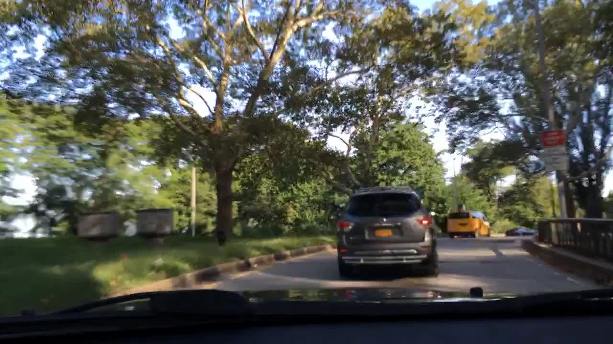
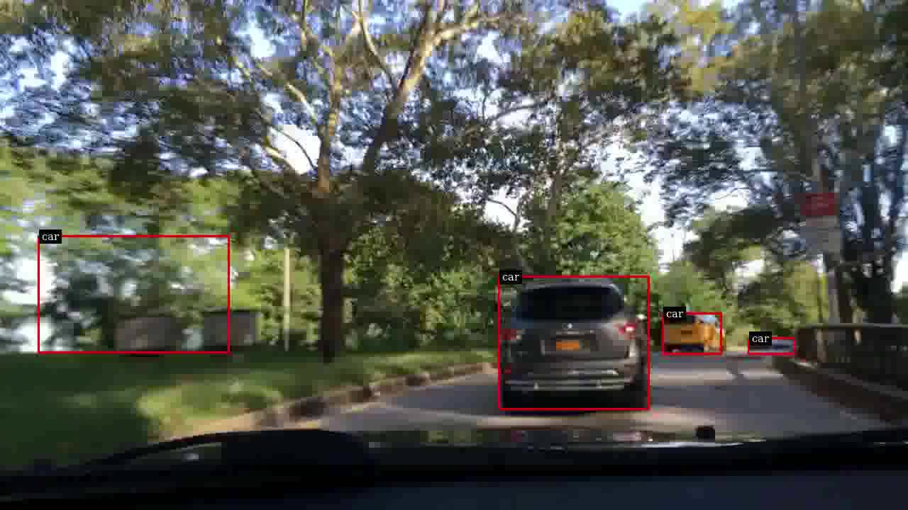

# AI-Powered Tailgating Detection

**NVIDIA DeepStream · TAO Toolkit / DashCamNet · GStreamer · Python · Video Analytics**

A deep learning and computer vision project for dashcam-based vehicle proximity monitoring. This project implements a custom DeepStream pipeline that detects cars and flags frames where a vehicle's bounding box suggests possible following at close visual proximity. The repository includes the GStreamer pipeline source code, automated testing, evidence-aware analysis, and a generated technical report.

## Real-world comparison

| Original dashcam feed | Annotated result |
|---|---|
|  |  |
| [Original stream](demo/assessment_stream.mp4) | [Annotated demo](demo/carros.mp4) |

Open [`demo/index.html`](demo/index.html) locally to compare both recordings side by side. Browser playback supports MP4.

## Problem and approach

This project simulates a fleet safety analytics scenario: find frames that might indicate a vehicle following another vehicle too closely. It uses NVIDIA **DashCamNet** (`pruned_v1.0`) for object detection, DeepStream / GStreamer for accelerated video processing, and a custom metadata pad probe for per-frame event logging.

```text
Dashcam (.h264)
      |
 filesrc → h264parse → nvv4l2decoder → nvstreammux
      |
   nvinfer (DashCamNet)
      |
   nvdsosd + pad probe ───────→ 0/1 indicator per frame
      |                                 |
 nvvideoconvert → encoder             event summaries
      |
  annotated video
```

For car bounding boxes, a **potential** tailgating signal is raised if:

```python
box.width > 0.30 * frame_width and (box.top + box.height) > 0.90 * frame_height
```

Frames get exactly **one** 0/1 flag, even if several vehicles are detected. This is a spatial heuristic, **not** a measured distance, time-headway or collision prediction. See [`src/tailgating.py`](src/tailgating.py).

## Technical details & pipeline specs

- The pipeline utilizes NVIDIA **DashCamNet**, specifically optimized for dashcam perspectives.
- The source video stream (`assessment_stream.mp4`) and annotated output (`carros.mp4`) run at **1280 × 720** resolution, **59.94 FPS**, with **2406 frames** (~**40.14 s** duration).
- The pipeline successfully visualizes the DeepStream Object Sensor Display (OSD), drawing red detection boxes labeled `car` over identified vehicles.

## Repository

```text
src/
  deepstream_infer.py      # core GPU inference pipeline
  tailgating.py           # complete frame-level decision rule
  video_info.py           # ffprobe inspection
  analyze_log.py          # timeline and event statistics
  create_report.py        # generates technical report
  assessment_answers.py   # handles metrics and pipeline artifacts
configs/dashcamnet.txt     # corrected config template for NGC model
demo/                      # original + annotated videos; browser comparison
assets/                    # screenshots, architecture diagrams
reports/TECHNICAL_REPORT.md
docs/ENVIRONMENT.md        # exact commands and compatibility caveats
docs/PROVENANCE.md         # documentation on original media sources
tests/                     # small unit test suite
models/dashcamnet/         # weights intentionally excluded
```

## Run offline tools (Windows + Python 3.13 OK)

Install [FFmpeg](https://ffmpeg.org/) so `ffprobe` is available, then:

```powershell
py -3.13 -m venv .venv
.\.venv\Scripts\Activate.ps1
python -m unittest discover -s tests -v
python -m src.video_info demo/assessment_stream.mp4 --output outputs/source.json
python -m src.video_info demo/carros.mp4 --output outputs/annotated.json
python -m src.create_report
```

## Execute inference on GPU

See [environment and exact pipeline commands](docs/ENVIRONMENT.md). This step requires Linux + compatible NVIDIA DeepStream / GStreamer / PyDS and the separately downloaded DashCamNet model. **Do not run the GPU pipeline in a Windows Python 3.13 venv.** A modern DeepStream deployment may require model conversion and an updated inference API.

Once an authentic inference log exists:

```bash
python -m src.analyze_log outputs/tailgating_flags.txt --fps 59.94005994
python -m src.create_report --log outputs/tailgating_flags.txt
```

This then produces quantitative summaries, contiguous episodes, and a refreshed report. 

## Project report

[Read the full technical report](reports/TECHNICAL_REPORT.md), automatically generated using `ffprobe` metadata. It includes the problem, methods, frames, source/annotated comparison, limitations, and learning outcomes.

## What I learned

- Connecting GStreamer components into a DeepStream pipeline.
- Configuring TAO pretrained models for `nvinfer` detection.
- Reading object metadata from DeepStream pad probes.
- Turning object-level detections into per-frame event signals.
- Documenting deployment limitations and pipeline architecture.

## Attribution and licensing

This project was independently developed and programmed, applying foundational concepts learned through NVIDIA DLI training. It utilizes NVIDIA technologies such as the DeepStream SDK and the DashCamNet pretrained model. NVIDIA and its respective licensors retain rights to their pretrained models and associated base assets. Video redistribution is subject to authorization; review before publication. [Details](docs/PROVENANCE.md).

## References

- [NVIDIA DashCamNet](https://catalog.ngc.nvidia.com/orgs/nvidia/tao/models/dashcamnet)
- [NVIDIA DeepStream SDK](https://docs.nvidia.com/deepstream/)
- [DeepStream Python Apps](https://github.com/NVIDIA-AI-IOT/deepstream_python_apps)