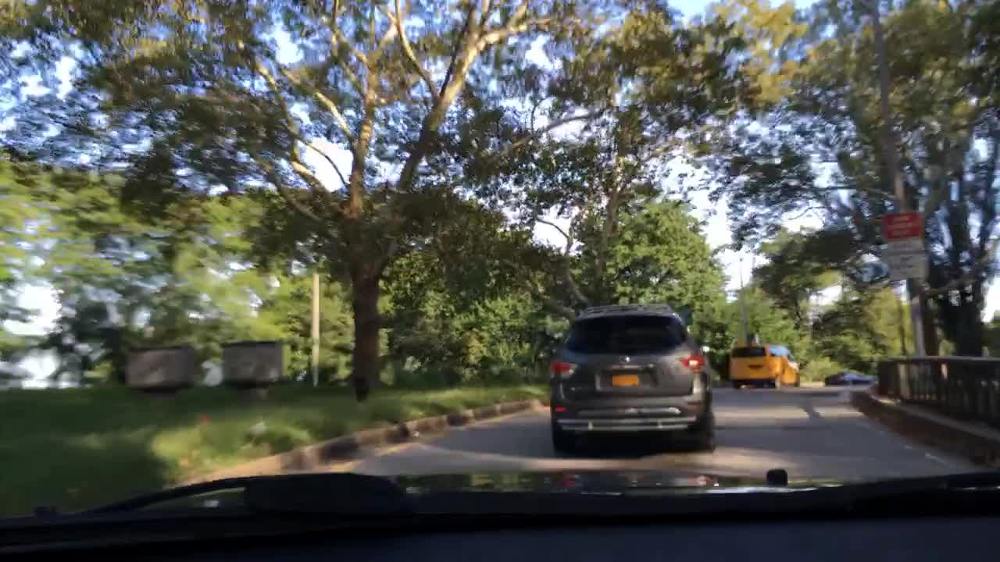
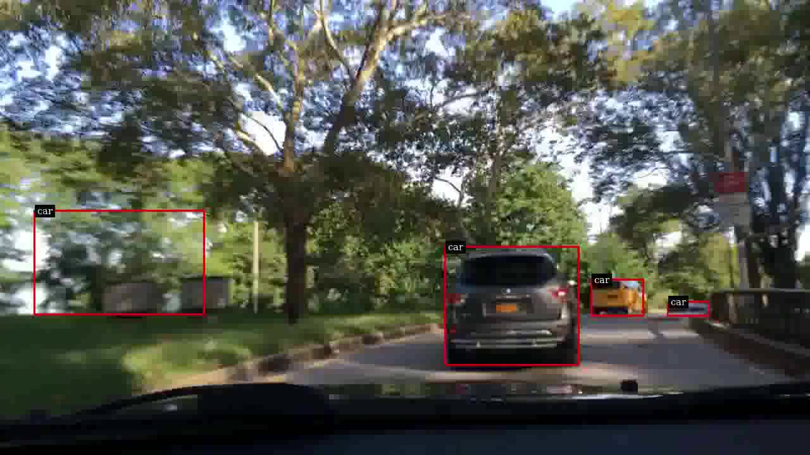

# Technical report — AI-Powered Tailgating Detection

> **Status:** archival demonstration + reconstructed source code. New GPU inference not revalidated.

## Executive summary

This project reconstructs the final assessment of an NVIDIA Deep Learning Institute video AI course. It uses a dashcam recording, DashCamNet vehicle detection, a GStreamer/DeepStream inference pipeline, and a frame-level bounding-box heuristic for **potential** tailgating. This is a proxy visual signal, not a physical inter-vehicle distance or a validated driving-safety classification.

## Problem and objectives

In a vehicle-fleet scenario, identify frames where a vehicle appears large and low in the camera image, review the resulting annotations, and summarize the share of frames flagged by this heuristic.

## Dataset and video properties

| Property | Original | Annotated result |
|---|---:|---:|
| File | `assessment_stream.mp4` | `carros.mp4` |
| Resolution | 1280 × 720 | 1280 × 720 |
| FPS | 59.94006 | 59.94006 |
| Frames | 2406 | 2406 |
| Duration | 40.140 s | 40.140 s |
| Video codec | h264 | h264 |
| Pixel format | yuv420p | yuv420p |

Video metadata compatible with frame-by-frame comparison: **Yes**.

## Methodology

1. Inspect input stream with `ffprobe` (codec, pixel format, resolution, FPS).
2. Download NVIDIA DashCamNet (`pruned_v1.0`) externally from NGC.
3. Set up a primary `nvinfer` detector with model-specific tensor dimensions.
4. Build GStreamer pipeline: filesrc → h264parse → NVIDIA decode → streammux → nvinfer → OSD → encoder → filesink.
5. Collect one binary `0`/`1` result **per frame** from inference metadata.
6. Export annotated video and frame-level log, compute flagged percentage and contiguous episodes.

## Detection rule

For each detected vehicle bounding box:

`box.width > 0.30 × frame.width AND (box.top + box.height) > 0.90 × frame.height`

Each frame is flagged if at least one detected vehicle satisfies both conditions.
The threshold is an image-coordinate heuristic from the course assessment. It does not estimate depth, braking distance, time headway, or account for road geometry.

## Results

The supplied annotated video visibly includes object-detection bounding boxes. The original and annotated clips can be compared, and their video metadata match.

**Quantitative tailgating findings are unavailable.** The recovered assessment files contain empty grading outputs and no per-frame binary log. A video with bounding boxes cannot uniquely reconstruct the metadata or exact flags produced by the original model. No percentages or risk scores are fabricated.

## Quality assurance and limitations

- Reconstructed Python unit tests assess the frame-level heuristic and log summaries.
- The supplied videos were inspected offline; new DeepStream GPU inference has **not** been executed here.
- The model weights must be obtained separately and runtime versions may need adjustment.
- False positives are possible for wide, low detections; missed cars can cause false negatives.
- This workflow demonstrates AI-assisted visual analysis, not a validated safety system.

## Provenance and reproducibility

Built around a course assessment from NVIDIA DLI, with assessment-specific logic reconstructed from the supplied notebook and further reorganized for a portfolio. The course materials and pretrained model belong to their respective owners. The videos were provided by the project author; public redistribution remains subject to applicable permissions.

## Learning outcomes

- GStreamer graph design, stream decoding, batching and downstream encoding.
- DeepStream primary inference and access to bounding-box metadata through pad probes.
- Rule-based reasoning and aggregation over per-frame model outputs.
- Technical reporting that distinguishes observed artifacts from unverified performance.

## References

- [NVIDIA DashCamNet model card](https://catalog.ngc.nvidia.com/orgs/nvidia/tao/models/dashcamnet)
- [NVIDIA DeepStream Python applications](https://github.com/NVIDIA-AI-IOT/deepstream_python_apps)
- [NVIDIA DeepStream documentation](https://docs.nvidia.com/deepstream/)

---

_Generated from actual video metadata; optional statistics require an authentic frame-level inference log._
